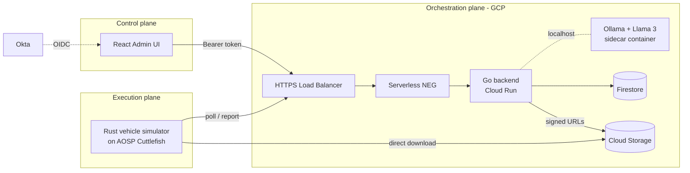

# Cloud-Native OTA Execution Platform (PoC)

End-to-end proof of concept for a cloud-native **Over-The-Air update platform for Software-Defined Vehicles**, built for my engineering internship at **Ampere Software Technology (Renault Group)**.

> ⚠️ **The source code is proprietary and not published.**
> This repository documents the architecture and my contributions in a generalized form.

## Context

Over-the-air updates are central to Software-Defined Vehicles, and many organizations rely on third-party OTA solutions. This project evaluated whether an **internally controlled, cloud-native OTA platform** could provide data sovereignty, architectural flexibility and tighter integration with in-house vehicle ecosystems. I designed, implemented and validated the PoC end to end.

## Architecture

The system is split into three logical planes to isolate trust boundaries and limit the blast radius of failures:

| Plane | Role | Tech |
|---|---|---|
| **Control** | Admin SPA to define campaigns, manage software packages, monitor fleet telemetry | React, Okta (OIDC) |
| **Orchestration** | Stateless backend: business logic, policy enforcement, state persistence, AI assistant | Go, Cloud Run, Firestore, Cloud Storage |
| **Execution** | Simulated connected vehicle polling, downloading and reporting | AOSP Cuttlefish, Rust |

## How an OTA campaign works

1. **Orchestration:** an admin defines the scope in the UI, and the backend generates a per-vehicle execution plan for every targeted vehicle.
2. **Polling:** the vehicle simulator polls the backend for pending updates and retrieves the update manifest.
3. **Smart inventory comparison:** the vehicle reports its current software inventory and the backend compares it against the manifest. Redundant updates are **skipped** (with a recorded reason) to save fleet bandwidth.
4. **Secure delivery:** for required updates, the backend issues **time-limited signed URLs** and the vehicle downloads binaries **directly from Cloud Storage**.
5. **Execution and reporting:** the vehicle installs the update and sends a status report, and the backend reconciles fleet state and deployment logs.

## Highlights

- **Clean Architecture in Go**: handlers, services and repositories separated, built on the standard `net/http` library to keep the image small and dependencies minimal.
- **Metadata vs payload separation**: the backend never proxies binaries. Large files are uploaded and downloaded through signed URLs, which keeps Cloud Run stateless and avoids memory spikes and timeouts.
- **Data-sovereign AI assistant**: a Llama 3 model served by Ollama runs as a **Cloud Run sidecar container**, reachable only via localhost by the backend, so no operational data leaves the cloud boundary.
- **Resilience to scale-to-zero**: the Rust simulator uses exponential backoff with jitter to absorb cold starts.
- **Lean containers**: multi-stage Docker builds bring the backend image under 20 MB to reduce cold-start latency.
- **Firestore modeling**: subcollections for deployment history to avoid concentrated writes.
- **Secure by design**: Okta SSO with OIDC for admins, token validation middleware in the backend, least-privilege IAM with dedicated service accounts, private networking inside a VPC.

## Engineering challenges

| Challenge | Solution |
|---|---|
| Proxying large binaries through serverless compute caused memory spikes and timeouts | Refactored to signed-URL delivery straight from Cloud Storage |
| Cold starts caused false-negative timeouts in the vehicle polling loop | Retry with exponential backoff and jitter |
| Running an LLM sidecar next to the backend on Cloud Run | Localhost networking and a persistent daemon entrypoint for the sidecar |

## Tech stack

| Area | Technologies |
|---|---|
| Backend | Go, Docker (multi-stage builds) |
| Frontend | React |
| Cloud | GCP: Cloud Run, Firestore, Cloud Storage, VPC, IAM, HTTPS Load Balancing, Serverless NEG, Artifact Registry, Secret Manager |
| Auth | Okta, OIDC |
| Simulation | AOSP Cuttlefish, Rust |
| AI | Llama 3, Ollama |

## Roadmap (documented in the report)

- Identity-Aware Proxy for edge-level access control
- mTLS and UPTANE-compliant signed updates with hardware-rooted vehicle identity
- Production hardening and a full observability stack

## Author

**Mohamed Khelifi**, Cloud & DevOps Engineer
[LinkedIn](https://linkedin.com/in/khelifimohamed) · [Portfolio](https://hamoda73.github.io)
