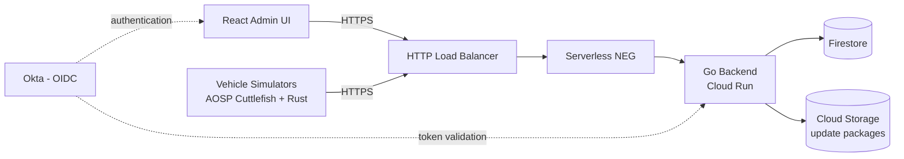

# Cloud-Native OTA Platform (PoC)

Proof of concept for a cloud-native Over-The-Air update platform for connected vehicles, built during my engineering internship at **Ampere Software Technology (Renault Group)**.

> ⚠️ **The source code is proprietary and not published.**
> This repository only documents the architecture and my contributions, in a generalized form.

## Context

The goal of this PoC was to evaluate whether a commercial OTA solution could be replaced by an in-house, cloud-native platform. The platform manages software deployment campaigns to vehicles and gives administrators visibility over the fleet.

## What I built

- **Backend services in Go**: campaign management, vehicle tracking, fleet administration
- **Admin interface in React**: create and monitor deployment campaigns, track vehicle status
- **Secure GCP infrastructure**: VPC, IAM, Service Accounts, Cloud Run, Firestore, Cloud Storage, HTTP Load Balancer with a Serverless NEG
- **Authentication**: Okta integration using OIDC
- **Vehicle simulators**: AOSP Cuttlefish virtual devices, driven by Rust scripts, to validate OTA communication between the cloud and embedded systems

## Architecture (simplified)

## Tech stack

| Area | Technologies |
|---|---|
| Backend | Go, Docker |
| Frontend | React |
| Cloud | GCP: Cloud Run, Firestore, Cloud Storage, VPC, IAM, Load Balancing, Serverless NEG |
| Auth | Okta, OIDC |
| Simulation | AOSP Cuttlefish, Rust |

## Key takeaways

- Designing a serverless, secure-by-default architecture on GCP
- Exposing Cloud Run services behind a global HTTP Load Balancer via a Serverless NEG
- Applying least-privilege IAM with dedicated Service Accounts
- Validating end-to-end OTA flows without physical hardware

## Author

**Mohamed Khelifi**: Cloud & DevOps Engineer
[LinkedIn](https://linkedin.com/in/khelifimohamed) · [Portfolio](https://hamoda73.github.io)
